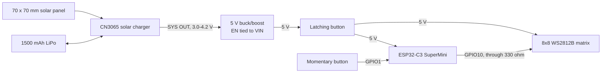

# solar-square

Solar Square is a solar-charged 8x8 RGB LED matrix that plays pixel art and animated patterns. It is the second project in the [Solar Eyes](https://github.com/hronkrobotics/solareyes) line: the same ESP32-C3 SuperMini and CN3065 solar charger, with the OLED swapped for 64 WS2812B LEDs, a much bigger battery, and a 70 x 70 mm solar panel. There is no Wi-Fi, Bluetooth, app, or account.

One button changes the pattern and its brightness. A latching button turns the whole thing on and off.

## Project Status

Version 0.1 firmware is written and compiles for the ESP32-C3 SuperMini. It has not been flashed to the hardware or assembled yet, so the matrix layout settings, brightness levels, and battery-life numbers below are still unconfirmed.

The plan is a square sandwich: the matrix on the front, the 70 x 70 mm solar panel on the back, and the battery and power boards in between.

## Patterns

| Pattern | What it does |
|---|---|
| Smiley | Yellow smiley face that blinks every few seconds |
| Heart | Red heart that beats with a double "lub-dub" pulse |
| Invader | Classic space invader, two-frame walk cycle |
| Rainbow | Diagonal rainbow that scrolls across the matrix |
| Plasma | Smooth, shifting color waves built from overlapping sine waves |
| Fire | Flames rising from the bottom row (Fire2012) |
| Rain | Green "digital rain" falling down each column at different speeds |
| Confetti | Random colored sparkles that fade out |
| Life | Conway's Game of Life on a wrap-around board; restarts when it gets stuck |

The last pattern and brightness are saved, so it comes back the same way after being switched off.

## Controls

| Input | Action |
|---|---|
| Latching button | Power on and off |
| Momentary button, short press | Next pattern |
| Momentary button, hold for 0.7 s | Next brightness level (four levels, then back to the lowest) |
## Hardware

| Part | Notes |
|---|---|
| ESP32-C3 SuperMini | Same board as Solar Eyes |
| 8x8 WS2812B RGB matrix | 64 addressable LEDs, 5 V, one data pin |
| YJ752560 LiPo, 3.7 V, 1500 mAh | 7.5 x 25 x 60 mm pouch cell. Check for a protection board under the tape at the lead end. |
| CN3065 solar charger | 4.4-6 V solar input, Micro-USB, 500 mA charge by default |
| 5 V buck/boost converter | Same CANADUINO module as Solar Eyes, 5 V at up to 600 mA, EN pin |
| 70 x 70 mm solar panel | Check the label: the CN3065 needs a 5-6 V panel |
| Latching push button | Main power switch |
| Momentary push button | Pattern and brightness control |
| 330 ohm resistor | In series with the matrix data line |
| 470 uF capacitor, 6.3 V or higher | Across the matrix's 5 V and GND |

## System Overview

The solar panel feeds the CN3065, which charges the 1500 mAh LiPo. The charger's SYS output follows the cell voltage, about 3.0 V to 4.2 V, and the buck/boost converter turns it into a steady 5 V. The latching button switches that 5 V rail, which powers both the SuperMini and the matrix. The SuperMini drives the matrix from one GPIO and reads the momentary button on another.



## Wiring

| From | To | Notes |
|---|---|---|
| Solar panel + / - | CN3065 solar input + / - | |
| LiPo + / - | CN3065 BAT + / - | Do this last: ground first, then positive. |
| CN3065 SYS OUT + / - | Converter VIN / GND | Battery-voltage rail into the converter |
| Converter EN | Converter VIN | **Required.** The converter puts out 0 V otherwise. |
| Converter 5 V | Latching button | The button switches the 5 V rail. |
| Latching button | SuperMini 5 V and matrix 5 V | Run the matrix's power straight from here, not through the SuperMini. |
| Converter GND | SuperMini GND and matrix GND | Common ground |
| SuperMini GPIO10 | 330 ohm resistor, then matrix DIN | Put the resistor close to the matrix. |
| 470 uF capacitor | Matrix 5 V and GND | Watch the polarity. Smooths the current spikes when LEDs switch on. |
| SuperMini GPIO1 | Momentary button, other leg to GND | Uses the ESP32's internal pull-up |

**The latching button's rating.** At full brightness the 5 V rail can draw about 500 mA. Use a button rated for at least 1 A. If yours is a small one rated lower, switch the converter's EN pin with it instead (EN to VIN through the button), which carries almost no current. In that setup the converter stays connected to the 5 V rail while off, so USB-C power can reach its output; unplug the battery before reflashing until that has been checked.

**Why these pins.** GPIO2, 8, and 9 are strapping pins that affect how the chip boots, so they are left alone. GPIO21 is avoided for the matrix because the bootloader prints on it at startup, which would flash random LEDs. GPIO3, 6, and 7 are kept free for an accelerometer later (interrupt on GPIO3, I2C on GPIO6 and GPIO7).

The SuperMini's USB-C port and its 5 V pin share one rail. **Turn the latching button off before plugging in USB-C** to reflash, so the converter and the USB port are never both driving it. The matrix still runs from USB power while it is plugged in.

## Power Notes

These are estimates, not measurements.

- **Brightness is capped.** A WS2812B can draw up to about 60 mA at full white, so all 64 could draw almost 4 A. The converter is rated for 600 mA, so the firmware tells FastLED to keep the LEDs under 450 mA and dims the whole frame when a pattern would go over.
- **The matrix draws power even when it's dark.** Each WS2812B uses roughly 1 mA just being powered, about 60 mA for the whole matrix. Use the latching button to turn it off rather than leaving it on a dark pattern.
- **Battery life** should be roughly 5 to 8 hours at the two lowest brightness levels, and around 2 hours at the highest.
- **Solar charging is a top-up, not a power source.** A 70 x 70 mm panel gives very roughly 100 to 200 mA in direct sun. A full charge from empty takes more than a day of sun, and it cannot keep up while the matrix is running. The Micro-USB port on the charger is faster.
- **The charge current fits the cell now.** The CN3065's default 500 mA is a third of this cell's capacity per hour, which is a normal charge rate. On Solar Eyes, the same charger was too fast for the 250 mAh cell.

## Firmware

The firmware is an Arduino sketch in [`solar_square/`](solar_square):

| File | Contents |
|---|---|
| `solar_square.ino` | Setup, button handling, saved settings, and the frame loop |
| `config.h` | Pins, matrix layout, power limit, and brightness levels |
| `matrix.h` | The LED buffer and the x/y to LED-number mapping |
| `sprites.h` | Pixel art for the smiley, heart, and invader |
| `patterns.h` | Every pattern |

It redraws about 60 times a second. Wi-Fi and Bluetooth are never started.

### Uploading

**PlatformIO (tested):** open the repo folder and run `pio run -t upload`. `platformio.ini` pins the ESP32 platform and FastLED versions that are known to build together.

**Arduino IDE:** open `solar_square/solar_square.ino` and use these settings:

| Setting | Value |
|---|---|
| Board package | esp32 by Espressif Systems, version 2.0.17 |
| Board | ESP32C3 Dev Module |
| USB CDC On Boot | Enabled |
| Library | FastLED, version 3.7.8 |

Use those exact versions. FastLED 3.10 does not compile against ESP32 core 2.0.17.

### Matrix layout

8x8 matrices are not all wired the same way. Rigid boards usually run every row left to right; flexible panels usually zigzag. If the smiley comes out scrambled, set `MATRIX_SERPENTINE` to `true` in `config.h`. If it is mirrored or rotated, use `MATRIX_FLIP_X`, `MATRIX_FLIP_Y`, or `MATRIX_TRANSPOSE`.

### Adding your own pixel art

Sprites are drawn as text, one string per row. Each letter picks a color from `spriteColor()` in `sprites.h`, and a `.` is an unlit pixel.

```cpp
const Sprite MY_SPRITE = {
  "..BBBB..",
  ".BWBBWB.",
  "BBBBBBBB",
  "BBBBBBBB",
  "BBBBBBBB",
  "BBBBBBBB",
  "B.B..B.B",
  "........",
};

void patternMySprite(uint32_t now, bool) {
  drawSprite(MY_SPRITE);
}
```

Then add `{"my sprite", patternMySprite}` to the `MODES` list in `solar_square.ino`.

## Notes and Limitations

- **Untested on hardware.** See [Project Status](#project-status).
- **3.3 V data into a 5 V matrix.** The SuperMini's 3.3 V data signal is just under what the WS2812B officially needs when powered at 5 V. It usually works with a short wire and the 330 ohm resistor. If the matrix flickers or shows random colors, add a 74AHCT125 level shifter on the data line.
- **USB-C and the 5 V pin share one rail.** Turn the latching button off before plugging in USB-C.
- **No battery gauge yet.** There is no way to see how much charge is left.

## Future Improvements

- Accelerometer for tilt and shake: pixel sand or water that flows as you tilt it, and shake to change patterns
- Battery-level reading on an ADC pin, shown on the matrix
- Deep sleep with wake on the button
- More pixel art and patterns
- A printed frame for the square sandwich

## References

- [FastLED](https://github.com/FastLED/FastLED), including the Fire2012 example the fire pattern is based on
- Previous version: [Solar Eyes](https://github.com/hronkrobotics/solareyes)
- CN3065 datasheet and the ESP32-C3 SuperMini pinout. Check the silkscreen on your own boards before applying power.

## Disclaimer

This is a LiPo project. Check polarity and the 5 V rail with a meter before connecting the microcontroller or the matrix. Do not charge a damaged or swollen pouch, and do not solder on the circuit while the battery's positive lead is connected.
