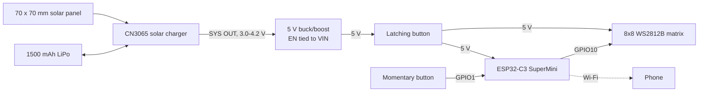
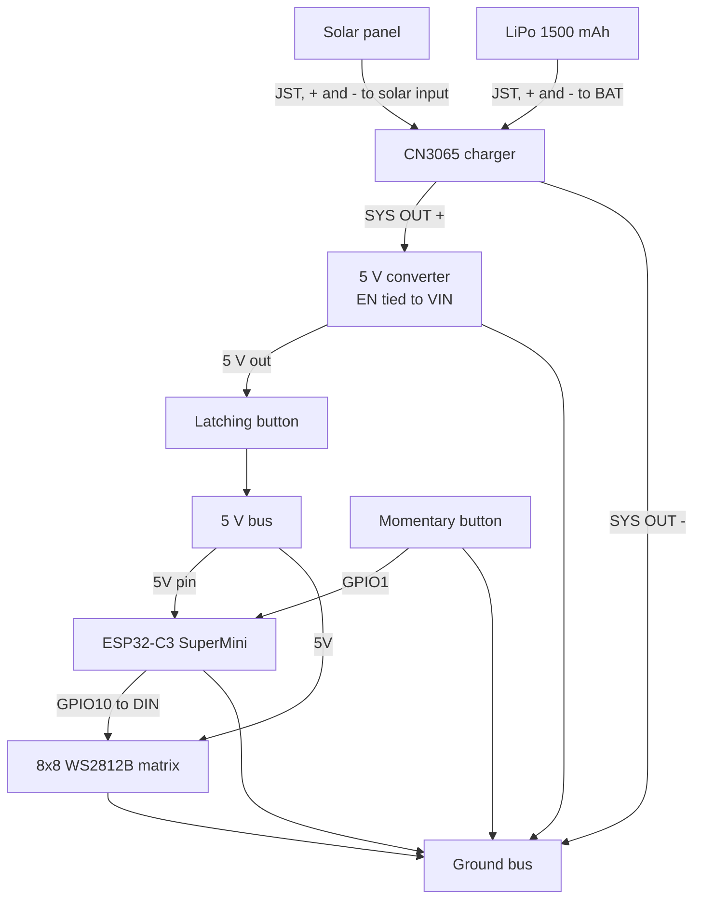
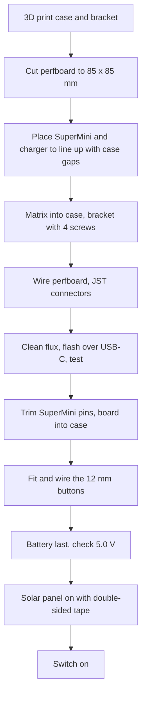

# solar-square

Solar Square is a solar-charged 8x8 RGB LED matrix in a 3D-printed case. It plays pixel art and animated patterns, and it hosts its own Wi-Fi network with a control page, so you can change patterns, set the brightness, and draw on it from your phone. No app, account, or internet connection is needed.

It is the second project in the [Solar Eyes](https://github.com/hronkrobotics/solareyes) line. Most of the electrical system is reused from Solar Eyes: the same ESP32-C3 SuperMini, CN3065 solar charger, and 5 V buck/boost converter. The OLED is swapped for 64 WS2812B LEDs, the battery is much bigger, and a 70 x 70 mm solar panel sits on the back.

A latching button turns it on and off. A second button changes the pattern and the brightness.

## Project Status

Version 0.1 is built and running the patterns. The phone control page is new and has not been tested on the hardware yet. Battery-life and charging numbers in this README are estimates, not measurements.

## Patterns

| Pattern | What it does |
|---|---|
| Smiley | Yellow smiley face that blinks every few seconds |
| Heart | Red heart that beats with a double "lub-dub" pulse |
| Invader | Classic space invader, two-frame walk cycle |
| Rainbow | Diagonal rainbow that scrolls across the matrix |
| Plasma | Smooth, shifting color waves built from overlapping sine waves |
| Fire | Flames rising from the bottom row (Fire2012) |
| Rain | Green "digital rain" falling down each column at different speeds |
| Confetti | Random colored sparkles that fade out |
| Life | Conway's Game of Life on a wrap-around board; restarts when it gets stuck |
| Drawing | Whatever you last drew on the phone control page |

The last pattern, brightness, and drawing are saved, so it comes back the same way after being switched off.

## Controls

| Input | Action |
|---|---|
| Latching button | Power on and off |
| Momentary button, short press | Next pattern |
| Momentary button, hold for 0.7 s | Next brightness level (four levels, then back to the lowest) |
| Phone | Pick a pattern, set any brightness, and draw. See [Phone Control](#phone-control). |

## System Overview

The solar panel feeds the CN3065, which charges the LiPo. The charger's SYS output follows the cell voltage, about 3.0 V to 4.2 V, and the buck/boost converter turns it into a steady 5 V. The latching button switches that 5 V rail, which powers both the SuperMini and the matrix. The SuperMini drives the matrix from one GPIO, reads the momentary button on another, and runs the Wi-Fi network and control page.



## Bill of Materials

Prices are Amazon.ca listing prices in CAD, checked between October 26 and November 3, 2026, before tax and shipping. Most of these are multi-packs, so one order leaves spares.

| Item | Listing | Notes | Used | Price / pack |
|---|---|---|---:|---:|
| ESP32-C3 SuperMini | [Lhnjimrsy ESP32-C3 SuperMini, 5-pack](https://www.amazon.ca/dp/B0F225PD47) | Same board as Solar Eyes | 1 of 5 | C$21.73 |
| 8x8 LED matrix | [GODIYMODULES WS2812B 8x8 matrix, 2-pack](https://www.amazon.ca/dp/B0F98W6MZ9) | 64 RGB LEDs, 66 x 66 mm rigid board, 5 V | 1 of 2 | C$25.02 |
| Solar panel | [Bettomshin 70 x 70 mm mini solar panel, 5-pack](https://www.amazon.ca/dp/B09SP1VNWQ) | 5 V, 0.7 W | 1 of 5 | C$23.99 |
| Solar charger | [CN3065 mini solar LiPo charger, 2-pack](https://www.amazon.ca/dp/B0DYZG2YLS) | Same as Solar Eyes. 4.4-6 V solar input, Micro-USB, 500 mA charge by default | 1 of 2 | C$12.99 |
| 5 V converter | [CANADUINO mini buck/boost converter, 3-pack](https://www.amazon.ca/dp/B0BRJVF6VS) | Same as Solar Eyes. 3-15 V in, 5 V at up to 600 mA, EN pin | 1 of 3 | C$6.99 |
| Latching button | [DMWD 12 mm latching push button, 2-pack](https://www.amazon.ca/dp/B0BYMSVM2G) | Power switch. Rated 5 A. The built-in LED is not used. | 1 of 2 | C$13.99 |
| Momentary button | [DMWD 12 mm momentary push button, 2-pack](https://www.amazon.ca/dp/B09YNPPTHV) | Pattern and brightness. The built-in LED is not used. | 1 of 2 | C$12.99 |
| JST connectors | [ASENENAELE JST-PH 2.0 2-pin pairs, 50-pack](https://www.amazon.ca/dp/B0G7993P35) | For the battery, solar panel, charger, matrix, and button connections | about 6 pairs | C$19.99 |
| Perfboard | [PATIKIL 15 x 9 cm double-sided perfboard, 2-pack](https://www.amazon.ca/dp/B0CF9HT34D) | Cut one down to 85 x 85 mm | 1 of 2 | C$17.29 |
| LiPo battery | YJ752560, 3.7 V, 1500 mAh | 7.5 x 25 x 60 mm pouch cell. The case is sized around it. Use one with a protection board. | 1 | |

**Total for the linked parts:** C$154.98, plus the battery.

Also needed, from parts on hand: four small screws for the matrix retaining bracket, 22-24 AWG hookup wire, double-sided tape, and 3D printer filament. A 330 ohm resistor and a 470 uF capacitor are recommended for the matrix (see [Wiring](#wiring)).

## Required Tools

| Tool | Purpose |
|---|---|
| 3D printer | The case and the matrix retaining bracket |
| Soldering iron and solder | All perfboard joints |
| Rosin flux | Getting solder to wet the SuperMini and module pins |
| Isopropyl alcohol (90%+) and a toothbrush | Cleaning flux off so pins do not leak current into each other |
| Multimeter | Polarity, the 5.0 V rail, and checking for shorts |
| Flush cutters | Trimming the SuperMini's pins flush |
| Hobby knife or small saw | Cutting the perfboard to size |
| Wire stripper | Jumper leads |
| Small screwdriver | The retaining bracket screws |
| Arduino IDE or PlatformIO | Uploading the firmware |

## 3D-Printed Parts

[`3d/solar-square-case.step`](3d/solar-square-case.step) contains both printed parts: the case and the matrix retaining bracket. Most slicers, including Bambu Studio, OrcaSlicer, and PrusaSlicer, open STEP files directly.

Clear PETG is recommended because it gives the most retro look, but realistically any filament works without issues.

## Board Layout

There is no fixed layout. The perfboard is cut to 85 x 85 mm, and there is plenty of room to place parts however you like, as long as you follow the [wiring diagram](#wiring). The layout used for this build shows up clearly in the build videos on [Instagram](https://www.instagram.com/hronk7/).

Two parts do have to go in specific spots: the ESP32-C3 SuperMini and the CN3065 charger. Their USB ports have to line up with the gaps in the side of the case, so you can still plug in to flash the firmware and to charge. Test-fit the board in the case before soldering them down.

## Wiring

Use a 5 V bus and a ground bus on the perfboard. Everything that needs 5 V takes it from the 5 V bus, and every ground goes to the ground bus.



| From | To | Notes |
|---|---|---|
| Solar panel + / - | CN3065 solar input + / - | Through a JST connector |
| LiPo + / - | CN3065 BAT + / - | Through a JST connector. Plug the battery in last. |
| CN3065 SYS OUT + | Converter VIN | Battery-voltage rail into the converter |
| Converter EN | Converter VIN | **Required.** The converter puts out 0 V otherwise. |
| Converter 5 V | Latching button, then the 5 V bus | The button switches the whole 5 V rail. |
| 5 V bus | SuperMini 5V pin and matrix 5V | |
| CN3065 SYS OUT -, converter GND, SuperMini GND, matrix GND | Ground bus | Common ground |
| SuperMini GPIO10 | Matrix DIN | Optional 330 ohm resistor in series, close to the matrix |
| SuperMini GPIO1 | Momentary button, other leg to the ground bus | Uses the ESP32's internal pull-up |
| 470 uF capacitor (optional) | Matrix 5V and GND | Watch the polarity. Smooths the current spikes when LEDs switch on. |

Leave the matrix's DOUT pad unconnected. It only feeds a second matrix.

**Why these pins.** GPIO2, 8, and 9 are strapping pins that affect how the chip boots, so they are left alone. GPIO21 is avoided for the matrix because the bootloader prints on it at startup, which would flash random LEDs. GPIO3, 6, and 7 are kept free for an accelerometer later.

**Use JST connectors.** They are absolutely recommended for completing this wiring, especially anything connected to the battery and the charging module. Soldering directly to battery leads is dangerous: one slip of the iron can short the cell. With connectors, the battery is the last thing you plug in and the first thing you unplug.

The SuperMini's USB-C port and its 5V pin share one rail. **Turn the latching button off before plugging in USB-C** to reflash, so the converter and the USB port are never both driving it.

## Assembly

### 1. 3D print the parts

Print the case and the retaining bracket from [`3d/solar-square-case.step`](3d/solar-square-case.step). Clear PETG is recommended; any filament works.

### 2. Cut the perfboard

Cut the perfboard down to 85 x 85 mm. Score both sides along a row of holes with a hobby knife and snap it, or use a small saw. Sand the edges so it slides into the case.

### 3. Place the SuperMini and the charger

Set the ESP32-C3 SuperMini and the CN3065 charger on the board so that, once the board is inside the case, their USB ports line up with the gaps in the side of the case. Test-fit the board in the case before soldering them. Place the 5 V converter and the buses wherever there is room.

### 4. Mount the matrix

Put the matrix into the case, LEDs facing out. Then fit the retaining bracket behind it and secure it with four screws from the outside of the case. The build videos on [Instagram](https://www.instagram.com/hronk7/) show this step.

### 5. Wire the perfboard

Wire everything following the [wiring table](#wiring): the 5 V and ground buses, the converter with EN tied to VIN, the SuperMini, and JST connectors for the battery, solar panel, matrix, and buttons. Do not plug in the battery yet.

If the solder balls up instead of sticking, add flux and hold the iron on the pin and the pad together for a couple of seconds before feeding solder in.

### 6. Clean and test

Scrub the flux off with isopropyl alcohol and a toothbrush, then let it dry completely. Check for solder bridges, and check with a meter that the 5 V bus is not shorted to ground.

Plug the matrix in, connect USB-C, and upload the firmware (see [Firmware](#firmware)). Confirm the smiley shows up. Fixing a problem is much easier now than after everything is in the case.

### 7. Fit the board into the case

Cut the excess pins off the bottom of the SuperMini with flush cutters so the board sits flush against the retaining bracket. The bracket also acts as a partial holder for the perfboard. Slide the board in with the USB ports lined up with their gaps.

### 8. Fit the buttons

Push the two 12 mm buttons into their holes and tighten their nuts. One is latching (power) and one is momentary (patterns). Wire them as in the [wiring table](#wiring): the latching button between the converter's 5 V output and the 5 V bus, and the momentary button between GPIO1 and ground.

### 9. Connect the battery last

1. Set the latching button to off.
2. Plug the LiPo's JST connector into the charger.
3. With the button still off, meter the converter's 5 V output to ground. It should read about 5.0 V.

### 10. Mount the solar panel

Plug the solar panel into the charger, then stick the 70 x 70 mm panel onto the back of the case with double-sided tape.

### 11. Switch it on

Press the latching button. The matrix should light up within a second.



## Firmware

The firmware is an Arduino sketch in [`solar_square/`](solar_square):

| File | Contents |
|---|---|
| `solar_square.ino` | Setup, button handling, and the frame loop |
| `config.h` | Pins, matrix layout, power limit, brightness levels, and Wi-Fi settings |
| `matrix.h` | The LED buffer and the x/y to LED-number mapping |
| `sprites.h` | Pixel art for the smiley, heart, and invader |
| `patterns.h` | Every pattern, and the order the button steps through them |
| `state.h` | The current pattern, brightness, and drawing, and saving them |
| `web.h` | The Wi-Fi network and the phone control page |

It redraws about 60 times a second. Bluetooth is never started.

### Uploading

**PlatformIO (tested):** open the repo folder and run `pio run -t upload`. `platformio.ini` pins the ESP32 platform and FastLED versions that are known to build together.

**Arduino IDE:** open `solar_square/solar_square.ino` and use these settings:

| Setting | Value |
|---|---|
| Board package | esp32 by Espressif Systems, version 2.0.17 |
| Board | ESP32C3 Dev Module |
| USB CDC On Boot | Enabled |
| Library | FastLED, version 3.7.8 |

Use those exact versions. FastLED 3.10 does not compile against ESP32 core 2.0.17.

If the upload fails with "could not open port", close any serial monitor and try again. When the ESP32 reboots, Windows drops and re-adds its USB serial port for a moment.

### Matrix layout

8x8 matrices are not all wired the same way. Rigid boards usually run every row left to right; flexible panels usually zigzag. The smiley, heart, and invader look the same either way, so check with the Drawing pattern: draw a single pixel in the top-left corner. If it lights up somewhere else, set `MATRIX_SERPENTINE`, `MATRIX_FLIP_X`, `MATRIX_FLIP_Y`, or `MATRIX_TRANSPOSE` in `config.h`.

### Adding your own pixel art

Sprites are drawn as text, one string per row. Each letter picks a color from `spriteColor()` in `sprites.h`, and a `.` is an unlit pixel.

```cpp
const Sprite MY_SPRITE = {
  "..BBBB..",
  ".BWBBWB.",
  "BBBBBBBB",
  "BBBBBBBB",
  "BBBBBBBB",
  "BBBBBBBB",
  "B.B..B.B",
  "........",
};

void patternMySprite(uint32_t now, bool) {
  drawSprite(MY_SPRITE);
}
```

Then add `{"my sprite", patternMySprite}` to the `MODES` list in `patterns.h`.

## Phone Control

Solar Square runs its own Wi-Fi network. Your phone connects straight to it; there is no router or internet involved.

1. **Switch Solar Square on.**
2. **Join its Wi-Fi network.** On your phone, open Wi-Fi settings and pick **SolarSquare-XXXX**. The last four characters are different on every board. The password is `solarsquare`.
3. **The control page opens by itself**, like the sign-in page on hotel Wi-Fi. If it does not, open a browser and go to **http://192.168.4.1**.
4. **Stay connected.** Your phone may warn that the network has no internet. Choose to stay connected. If the page will not load, turn off mobile data for a minute; some phones send web requests over mobile data when the Wi-Fi has no internet.

On the page:

- **Pattern:** tap any pattern to show it.
- **Brightness:** drag the slider. It goes beyond the four button levels in both directions.
- **Draw:** pick a color, then tap or drag across the 8x8 grid. The matrix switches to the Drawing pattern and updates as you draw. Black is the eraser, the last swatch opens a custom color picker, **Clear** blanks the grid, and **Fill** paints every pixel in the current color. The drawing is saved, so it is still there as the Drawing pattern after a power cycle.

The physical button keeps working while a phone is connected, and the page catches up within a few seconds.

To change the network name or password, edit `WIFI_NAME_PREFIX` and `WIFI_PASSWORD` in `config.h`. The password has to be at least 8 characters. The board's USB serial output also prints the network name at startup.

To turn Wi-Fi off completely for longer battery life, set `WIFI_ENABLED` to `false` in `config.h`.

## Power Notes

These are estimates, not measurements.

- **Brightness is capped.** A WS2812B can draw up to about 60 mA at full white, so all 64 could draw almost 4 A. The converter is rated for 600 mA, and Wi-Fi can pull about 200 mA of that in bursts, so the firmware keeps the LEDs under 350 mA and dims the whole frame when a pattern would go over.
- **The matrix draws power even when it's dark.** Each WS2812B uses roughly 1 mA just being powered, about 60 mA for the whole matrix. Use the latching button to turn it off rather than leaving it on a dark pattern.
- **Battery life** should be roughly 4 hours at the two lowest brightness levels with Wi-Fi on, and closer to 6 hours with Wi-Fi turned off.
- **Solar charging is a top-up, not a power source.** The 0.7 W panel gives at most about 140 mA in direct sun. A full charge from empty takes more than a day of sun, and it cannot keep up while the matrix is running. The Micro-USB port on the charger is faster.
- **The charge current fits the cell.** The CN3065's default 500 mA is a third of a 1500 mAh cell's capacity per hour, which is a normal charge rate. On Solar Eyes, the same charger was too fast for the 250 mAh cell.

## Notes and Limitations

Version 0.1 is a proof of concept, and it has known rough edges. Future versions will attempt to resolve these in some capacity.

- **The phone control page is untested on hardware.** See [Project Status](#project-status).
- **Anyone with the password can control it.** Change the default password in `config.h` if that matters to you.
- **Weak Wi-Fi range.** Many SuperMini boards have a poor antenna match, so the firmware lowers the transmit power, which is the common fix. Expect a range of a few meters, not a whole house.
- **3.3 V data into a 5 V matrix.** The SuperMini's 3.3 V data signal is just under what the WS2812B officially needs when powered at 5 V. It usually works with a short wire. If the matrix flickers or shows random colors, add a 74AHCT125 level shifter on the data line.
- **USB-C and the 5V pin share one rail.** Turn the latching button off before plugging in USB-C.
- **No battery gauge yet.** There is no way to see how much charge is left.

## Future Improvements

- Accelerometer for tilt and shake: pixel sand or water that flows as you tilt it, and shake to change patterns
- Battery-level reading on an ADC pin, shown on the matrix
- Deep sleep with wake on the button
- More pixel art and patterns
- Build photos in this README

## References

- [FastLED](https://github.com/FastLED/FastLED), including the Fire2012 example the fire pattern is based on
- Previous version: [Solar Eyes](https://github.com/hronkrobotics/solareyes)
- Build videos: [@hronk7 on Instagram](https://www.instagram.com/hronk7/)
- CN3065 datasheet and the ESP32-C3 SuperMini pinout. Check the silkscreen on your own boards before applying power.

## Disclaimer

Be very careful with the battery. LiPo pouch cells can overheat, swell, or catch fire if they are shorted, punctured, bent, or overcharged.

- Use JST connectors instead of soldering to the battery leads, and never solder anything while the battery is plugged in.
- Check polarity before plugging the battery in. Reversing a LiPo can destroy the charger instantly.
- Do not bend, puncture, or squeeze the pouch, and keep screws and sharp solder joints away from it inside the case.
- Do not charge a damaged or swollen cell, and do not leave it charging unattended.
- Check the 5 V rail with a meter before connecting the microcontroller or the matrix.
